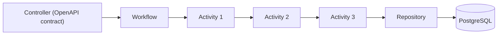

# Harpia Arch

A Java architecture for building processes with **Activities**, **Workflows** and hierarchical
composition, on top of Quarkus.

The goal is to abstract orchestration complexity without abstracting execution efficiency: strong
typing, build-time composition, native CDI, direct Java calls and GraalVM Native Image support.

## Highlights

- **Strongly typed**: the output of an Activity must be the input of the next one.
- **Hierarchical composition**: a Workflow is a step of another Workflow.
- **Explicit context**: passed as a parameter, with typed adaptation when needed.
- **Single construction**: `configure()` runs in `@PostConstruct` and the flow is reused.
- **No reflection on the hot path**: no dynamic discovery, proxies or `Method.invoke`.
- **Build-time validation**: architectural rules fail the Quarkus build.
- **No `Object` in the chain**: composition through closures with concrete types.
- **Native Image**: tested with Hibernate ORM, H2 and REST.

## Architecture



## Modules

| Module | Role |
|---|---|
| [`harpia-core`](modules.md) | Workflow engine, annotations and CDI stereotypes. |
| [`harpia-core-deployment`](modules.md) | Build-time architectural validation (automatic). |
| [`harpia-quarkus`](modules.md) | Recommended parent POM for Quarkus applications. |
| [`harpia-arch`](modules.md) | Build parent for the library. |

## Quick start

```xml
<parent>
    <groupId>io.github.krisner94</groupId>
    <artifactId>harpia-quarkus</artifactId>
    <version>1.0.0</version>
</parent>
```

```java
@Activity
public class ValidateCustomerActivity
        implements FlowItem<CustomerInput, CustomerContext, CustomerInput> {

    @Override
    public CustomerInput execute(CustomerInput input, CustomerContext context) {
        return input;
    }
}
```

```java
@WorkflowDefinition
public class CreateCustomerWorkflow
        extends Workflow<CustomerInput, CustomerContext, Customer> {

    private final ValidateCustomerActivity validate;

    public CreateCustomerWorkflow(ValidateCustomerActivity validate) {
        this.validate = validate;
    }

    @Override
    protected void configure() {
        flowBuilder = FlowBuilder.builder(CustomerInput.class, CustomerContext.class)
                .step(validate)
                .build();
    }
}
```

Continue with [Getting started](getting-started.md).

## Documentation

- [Getting started](getting-started.md)
- [Modules and coordinates](modules.md)
- [Workflow engine](core/workflow-engine.md)
- [Annotations](core/annotations.md)
- [Build validation](core/build-validation.md)
- [Contract First](guides/contract-first.md)
- [Persistence](guides/persistence.md)
- [Security](guides/security.md)
- [Native Image](guides/native-image.md)
- [Benchmarks](guides/benchmarks.md)
- [Maven Central](guides/maven-central.md)
- [Architectural decisions](architecture/decisions.md)
- [Java API](reference/api.md)
- [FAQ](faq.md)
