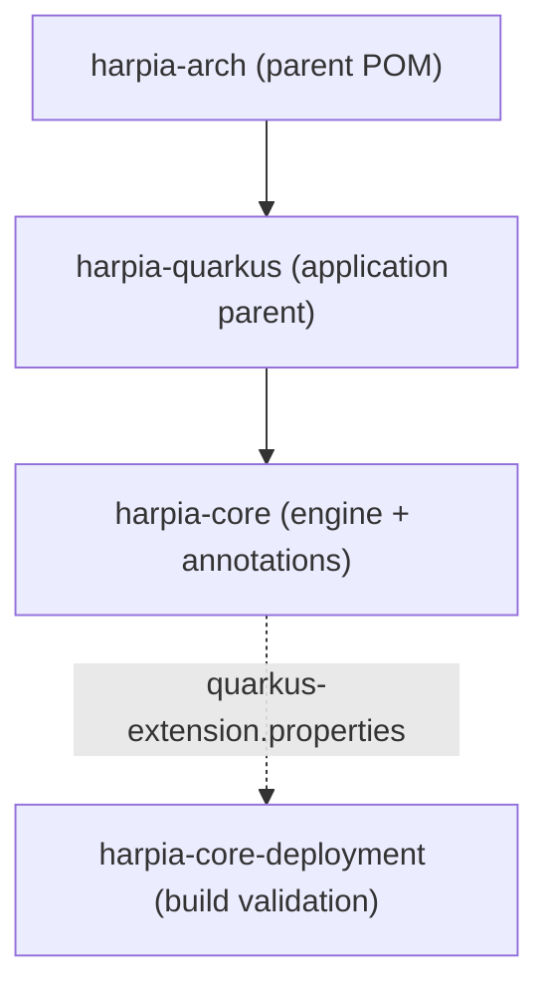

# Modules and coordinates

## Published artifacts

| Coordinate | Type | Consumption |
|---|---|---|
| `io.github.krisner94:harpia-arch:1.0.0` | POM | Library build parent |
| `io.github.krisner94:harpia-quarkus:1.0.0` | POM | **Recommended parent for applications** |
| `io.github.krisner94:harpia-core:1.0.0` | JAR | Engine, annotations and stereotypes |
| `io.github.krisner94:harpia-core-deployment:1.0.0` | JAR | Build-time validation (automatic) |

## Module relationships



## When to use each one

### `harpia-quarkus`

Use it as the application parent:

```xml
<parent>
    <groupId>io.github.krisner94</groupId>
    <artifactId>harpia-quarkus</artifactId>
    <version>1.0.0</version>
</parent>
```

It provides:

- Quarkus BOM;
- `quarkus-arc`, `quarkus-rest` and `quarkus-rest-jackson`;
- `harpia-core`;
- JUnit and Rest Assured in test scope;
- compiler, Surefire and Quarkus plugins;
- `native` profile with Failsafe;
- OpenAPI contract-first generation profile.

### `harpia-core`

Use it as a dependency when the application already has another parent:

```xml
<dependency>
    <groupId>io.github.krisner94</groupId>
    <artifactId>harpia-core</artifactId>
    <version>1.0.0</version>
</dependency>
```

In this case, declare the Quarkus extensions your application uses (`quarkus-rest`,
`quarkus-rest-jackson`, etc.) and configure OpenAPI code generation in your POM.

It contains:

- `FlowItem`, `Workflow`, `FlowBuilder`, `FlowConfigurationException`;
- `@HarpiaApplication`, `@Controller`, `@Service`, `@Repository`, `@Activity`,
  `@WorkflowDefinition`, `@Component`;
- the Quarkus extension descriptor.

### `harpia-core-deployment`

Do not declare it. Quarkus resolves this artifact from the `harpia-core` descriptor during the
build. It registers the annotations as bean-defining annotations and runs
[architectural validation](core/build-validation.md).

### `harpia-arch`

Library build parent. It organizes the reactor, imports the Quarkus BOM and configures the
`harpia-openapi-codegen` profile.

It is not a runtime dependency and is not the recommended parent for applications. Use
`harpia-quarkus` for applications.

## Internal modules

| Module | Role | Published |
|---|---|---|
| `harpia-integration-tests` | Quarkus tests with Hibernate ORM, H2, REST and Native Image | No |
| `harpia-benchmarks` | JMH benchmarks | No |

## Version and Java

- Current version: `1.0.0`.
- Java: 25.
- Quarkus: 3.40+.
- GroupId: `io.github.krisner94`.
