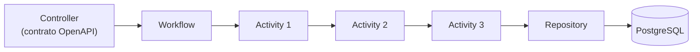

# Harpia Arch

Arquitetura Java para construção de processos com **Activities**, **Workflows** e composição
hierárquica, sobre Quarkus.

O objetivo é abstrair a complexidade de orquestração sem abstrair a eficiência: tipagem forte,
construção em tempo de compilação/build, CDI nativo, execução por chamadas Java diretas e
compatibilidade com GraalVM Native Image.

## Principais características

- **Fortemente tipado**: a saída de uma Activity precisa ser a entrada da próxima.
- **Composição hierárquica**: um Workflow é uma etapa de outro Workflow.
- **Contexto explícito**: recebido por parâmetro, com adaptação tipada quando necessário.
- **Uma única construção**: `configure()` roda no `@PostConstruct` e o fluxo é reutilizado.
- **Sem reflexão no caminho crítico**: nenhuma descoberta dinâmica, proxy ou `Method.invoke`.
- **Validação em build time**: regras arquiteturais falham o build do Quarkus.
- **Sem `Object` no encadeamento**: composição por closures com tipos concretos.
- **Native Image**: testado com Hibernate ORM, H2 e REST.

## Arquitetura



## Módulos

| Módulo | Papel |
|---|---|
| [`harpia-core`](modules.md) | Engine de workflows, annotations e stereotypes CDI. |
| [`harpia-core-deployment`](modules.md) | Validação arquitetural em build time (automático). |
| [`harpia-quarkus`](modules.md) | Parent POM recomendado para aplicações Quarkus. |
| [`harpia-arch`](modules.md) | Parent de build da biblioteca. |

## Início rápido

```xml
<parent>
    <groupId>io.github.krisner94</groupId>
    <artifactId>harpia-quarkus</artifactId>
    <version>1.0.0</version>
</parent>
```

```java
@Activity
public class ValidateCustomerActivity
        implements FlowItem<CustomerInput, CustomerContext, CustomerInput> {

    @Override
    public CustomerInput execute(CustomerInput input, CustomerContext context) {
        return input;
    }
}
```

```java
@WorkflowDefinition
public class CreateCustomerWorkflow
        extends Workflow<CustomerInput, CustomerContext, Customer> {

    private final ValidateCustomerActivity validate;

    public CreateCustomerWorkflow(ValidateCustomerActivity validate) {
        this.validate = validate;
    }

    @Override
    protected void configure() {
        flowBuilder = FlowBuilder.builder(CustomerInput.class, CustomerContext.class)
                .step(validate)
                .build();
    }
}
```

Continue em [Primeiros passos](getting-started.md).

## Documentação

- [Primeiros passos](getting-started.md)
- [Módulos e coordenadas](modules.md)
- [Workflow engine](core/workflow-engine.md)
- [Annotations](core/annotations.md)
- [Validação em build](core/build-validation.md)
- [Contract First](guides/contract-first.md)
- [Persistência](guides/persistence.md)
- [Segurança](guides/security.md)
- [Native Image](guides/native-image.md)
- [Benchmarks](guides/benchmarks.md)
- [Maven Central](guides/maven-central.md)
- [Decisões arquiteturais](architecture/decisions.md)
- [API Java](reference/api.md)
- [FAQ](faq.md)
