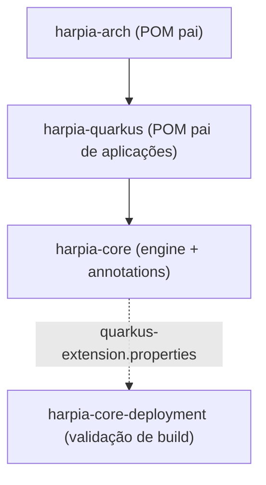

# Módulos e coordenadas

## Artefatos publicados

| Coordenada | Tipo | Consumo |
|---|---|---|
| `io.github.krisner94:harpia-arch:1.0.0` | POM | Parent de build da biblioteca |
| `io.github.krisner94:harpia-quarkus:1.0.0` | POM | **Parent recomendado para aplicações** |
| `io.github.krisner94:harpia-core:1.0.0` | JAR | Engine, annotations e stereotypes |
| `io.github.krisner94:harpia-core-deployment:1.0.0` | JAR | Validação em build time (automático) |

## Relação entre os módulos



## Quando usar cada um

### `harpia-quarkus`

Use como parent da aplicação:

```xml
<parent>
    <groupId>io.github.krisner94</groupId>
    <artifactId>harpia-quarkus</artifactId>
    <version>1.0.0</version>
</parent>
```

Fornece:

- Quarkus BOM;
- `quarkus-arc`, `quarkus-rest` e `quarkus-rest-jackson`;
- `harpia-core`;
- JUnit e Rest Assured em escopo de teste;
- plugins de compilação, Surefire e Quarkus;
- perfil `native` com Failsafe;
- perfil de geração OpenAPI contract-first.

### `harpia-core`

Use como dependência quando a aplicação já tem outro parent:

```xml
<dependency>
    <groupId>io.github.krisner94</groupId>
    <artifactId>harpia-core</artifactId>
    <version>1.0.0</version>
</dependency>
```

Nesse caso, declare também as extensões Quarkus que a aplicação usa (`quarkus-rest`,
`quarkus-rest-jackson`, etc.) e configure o codegen OpenAPI no seu POM.

Contém:

- `FlowItem`, `Workflow`, `FlowBuilder`, `FlowConfigurationException`;
- `@HarpiaApplication`, `@Controller`, `@Service`, `@Repository`, `@Activity`,
  `@WorkflowDefinition`, `@Component`;
- o descritor da extensão Quarkus.

### `harpia-core-deployment`

Não declare. O Quarkus resolve esse artefato a partir do descritor do `harpia-core` durante o
build. Ele registra as annotations como bean-defining annotations e executa a
[validação arquitetural](core/build-validation.md).

### `harpia-arch`

Parent de build da biblioteca. Organiza o reactor, importa o Quarkus BOM e configura o perfil
`harpia-openapi-codegen`.

Não é uma dependência de runtime e não é o parent recomendado para aplicações. Para aplicações,
use `harpia-quarkus`.

## Módulos internos

| Módulo | Papel | Publicado |
|---|---|---|
| `harpia-integration-tests` | Testes Quarkus com Hibernate ORM, H2, REST e Native Image | Não |
| `harpia-benchmarks` | Benchmarks JMH | Não |

## Versão e Java

- Versão atual: `1.0.0`.
- Java: 25.
- Quarkus: 3.40+.
- GroupId: `io.github.krisner94`.
