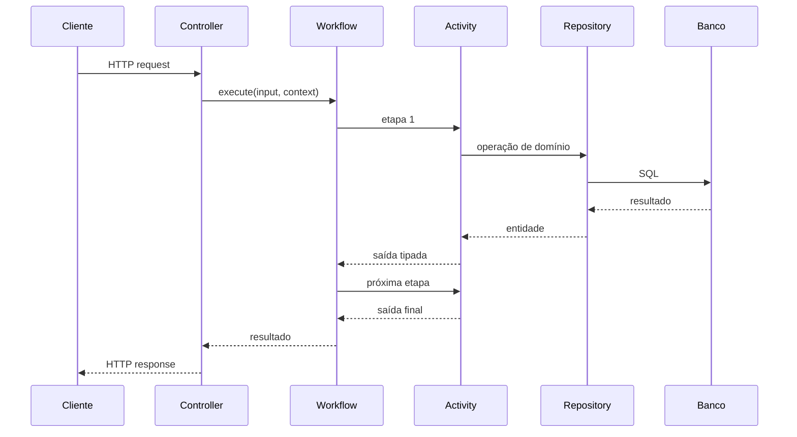
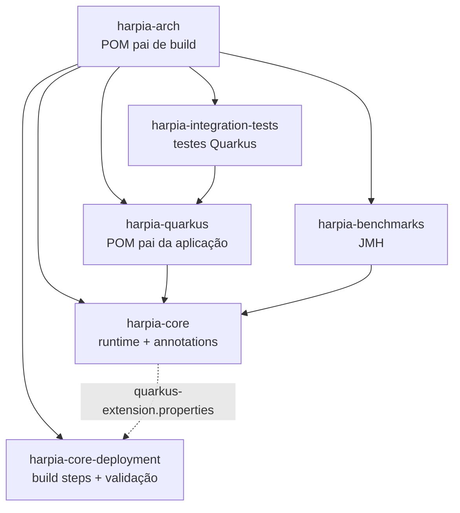
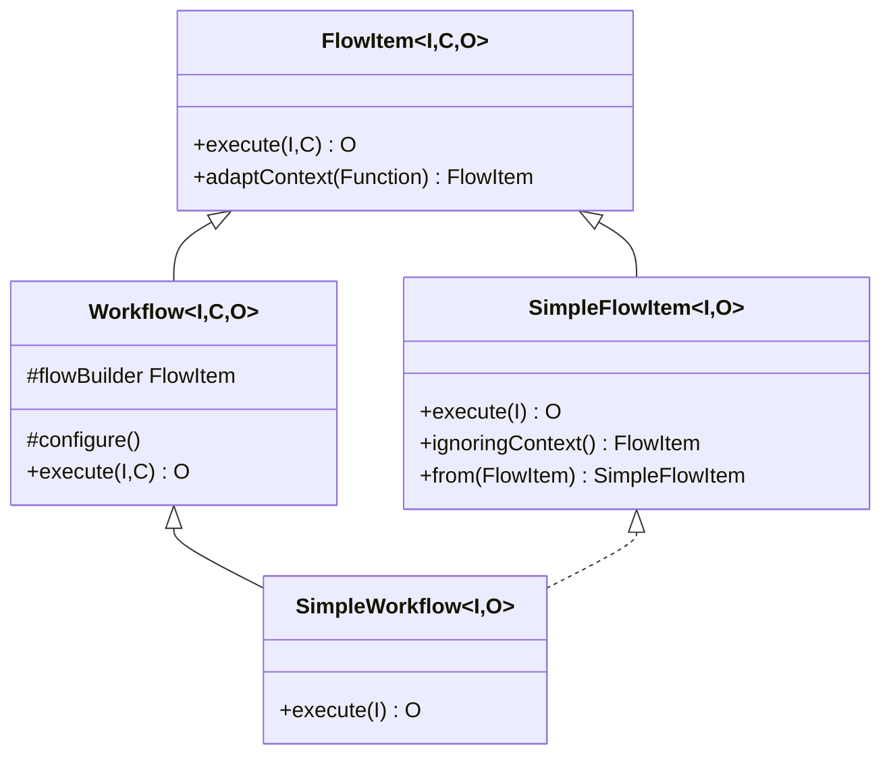

# Visão geral da arquitetura

O Harpia Arch organiza uma aplicação Quarkus em torno de três ideias:

1. **contrato explícito** — a entrada e a saída de cada etapa são tipos Java;
2. **composição declarativa** — o Workflow declara a ordem das Activities;
3. **validação antecipada** — erros de arquitetura e de composição aparecem antes da execução.

O resultado é um fluxo previsível: o Controller adapta HTTP, o Workflow coordena o caso de uso,
as Activities executam regras de negócio e o Repository isola a persistência.

## Camadas e responsabilidades

| Camada | Annotation | Responsabilidade | Não deve |
|---|---|---|---|
| Entrada HTTP | `@Controller` | Implementar a interface gerada pelo OpenAPI e traduzir HTTP para o Workflow | Declarar `@Path`, verbos ou implementar `FlowItem` |
| Orquestração | `@WorkflowDefinition` | Declarar a ordem das etapas e o contrato de entrada/saída | Conter regra de negócio ou acesso direto ao banco |
| Etapa | `@Activity` | Executar uma responsabilidade coesa do fluxo | Conhecer o Workflow inteiro ou expor HTTP |
| Regra de negócio | `@Service` | Concentrar regras reutilizáveis por Activities e outros serviços | Expor endpoints ou depender de Controller |
| Persistência | `@Repository` | Isolar `EntityManager`, consultas e detalhes de storage | Depender de Controller, Service ou Activity |
| Genérico | `@Component` | Papel auxiliar quando nenhuma categoria específica se aplica | Substituir uma camada sem justificativa |

As regras explícitas de camada — por exemplo, `@Repository` não depende de `@Controller` — são
verificadas no build pelo `harpia-core-deployment`. As demais separações da tabela são diretrizes
arquiteturais. Consulte [Validação em build](../core/build-validation.md).

## Fluxo de uma requisição

O Workflow não conhece HTTP. O Controller não conhece a ordem das Activities. Essa separação
permite testar o caso de uso sem subir a camada web e testar o adapter HTTP separadamente.

## Estrutura do reator

O `harpia-core` é o artefato de runtime. O `harpia-core-deployment` é carregado pelo Quarkus
durante o build e não é declarado pela aplicação. Consulte [Módulos](../modules.md) para as
coordenadas e o papel de cada artefato.

## Runtime e build time

| Momento | O que acontece | Onde |
|---|---|---|
| Geração de fontes | O contrato OpenAPI vira interfaces JAX-RS e DTOs | `openapi-generator-maven-plugin` |
| Compilação | O compilador verifica entrada, saída e contexto de cada `.step()` | `javac` |
| Build Quarkus | As annotations são registradas e as regras arquiteturais são validadas com Jandex | `harpia-core-deployment` |
| Inicialização CDI | O `@PostConstruct` chama `configure()` uma vez | `Workflow` |
| Execução | A composição imutável é percorrida por chamadas Java diretas | `FlowItem`/`Stage` |

Não há descoberta dinâmica de Activities, leitura de annotations por reflexão no caminho crítico
nem resolução do tipo de contexto em runtime. O ArC pode criar proxies CDI para beans
`@ApplicationScoped`; isso é responsabilidade do container e não altera a composição tipada.

## Modelo de tipos

A hierarquia permite quatro formas de unidade executável:

- `FlowItem<I, C, O>` — Activity com contexto;
- `SimpleFlowItem<I, O>` — Activity sem contexto;
- `Workflow<I, C, O>` — Workflow com contexto;
- `SimpleWorkflow<I, O>` — Workflow sem contexto.

Um `SimpleFlowItem` é um `FlowItem<I, Void, O>`, portanto continua compatível com o contrato
completo. Um `SimpleWorkflow` também é um `SimpleFlowItem`, o que permite usá-lo como etapa de
outro fluxo.

## Ciclo de vida

1. O container cria o bean `@ApplicationScoped`.
2. O `@PostConstruct` chama `initialize()`.
3. `configure()` monta o `flowBuilder` uma única vez.
4. `execute()` lê a composição publicada e a percorre.
5. Execuções seguintes reutilizam a mesma composição.

O campo `flowBuilder` é `volatile`. A composição é imutável depois da construção; não há
`ThreadLocal`, estado global ou dados de requisição em campos do Workflow.

Detalhes em [Workflow engine](../core/workflow-engine.md#ciclo-de-vida).

## Contexto

O contexto é opcional. Há duas formas suportadas:

- declarar `Void` explicitamente e continuar no contrato de três parâmetros;
- omitir o contexto com `SimpleFlowItem`/`SimpleWorkflow`.

A ausência de contexto não cria um objeto vazio, não usa reflexão e não faz resolução dinâmica.
Consulte [Contexto opcional](../core/context.md) para a matriz completa de composição.

## Qualidades e trade-offs

| Qualidade | Como é obtida | Trade-off |
|---|---|---|
| Segurança de tipos | Genéricos + builder que muda o tipo de saída | Curva de aprendizado dos contratos |
| Falha cedo | Compilação + validação Jandex | O build fica mais rígido |
| Desempenho | Chamadas diretas, composição construída uma vez | O fluxo é declarativo, não dinâmico |
| Concorrência | Composição imutável e contexto por execução | O contexto precisa ser thread-safe se for mutável |
| Native Image | Sem descoberta reflexiva no motor | Dependências ainda precisam de suporte Quarkus |
| Testabilidade | Workflow é um `FlowItem`; Activities são beans | Exige disciplina de camadas |

## O que não faz parte do núcleo

- Saga, compensação e rollback automático;
- retry automático;
- observabilidade, tracing e métricas embutidos;
- descoberta dinâmica de Activities;
- conversão implícita entre contextos.

Esses comportamentos podem ser implementados na aplicação ou em módulos futuros. Consulte as
[Decisões arquiteturais](decisions.md).
