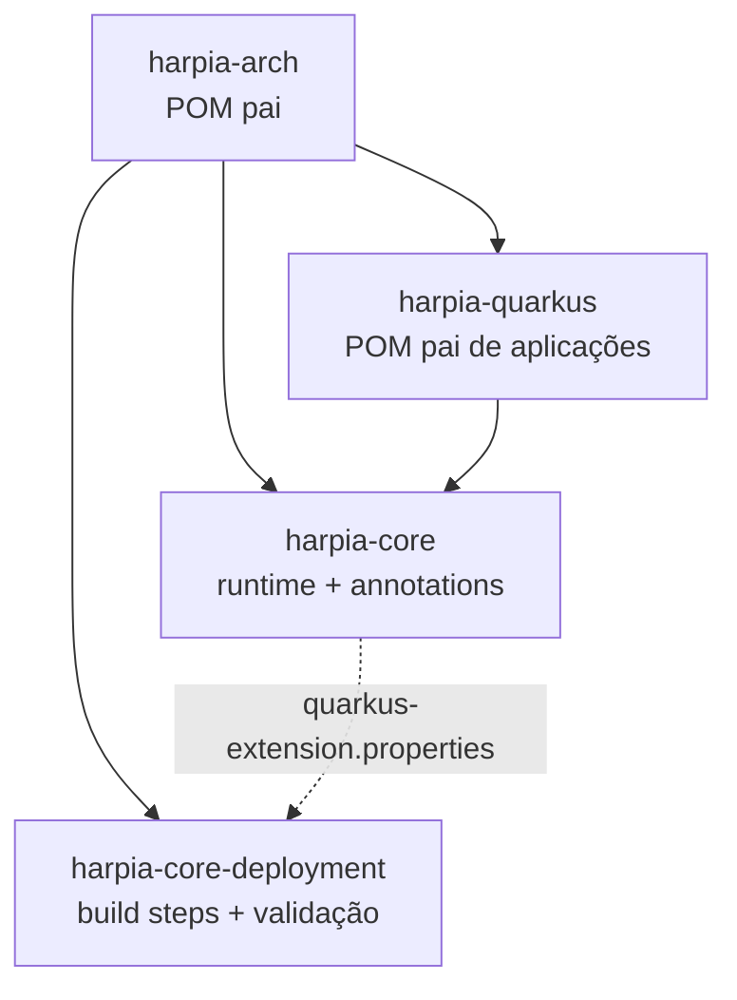

# Módulos e coordenadas

## Artefatos publicados

| Coordenada | Tipo | Consumo |
|---|---|---|
| `io.github.krisner94:harpia-arch:1.0.0` | POM | Parent de build da biblioteca |
| `io.github.krisner94:harpia-quarkus:1.0.0` | POM | **Parent recomendado para aplicações** |
| `io.github.krisner94:harpia-core:1.0.0` | JAR | Engine, annotations e stereotypes |
| `io.github.krisner94:harpia-core-deployment:1.0.0` | JAR | Validação em build time (automático) |

## Relação entre os módulos



O Quarkus lê o descritor do `harpia-core`, resolve o `harpia-core-deployment` e executa os build
steps durante o build. A aplicação nunca declara o deployment.

## Ordem do reactor

| Ordem | Módulo | Papel |
|---|---|---|
| 1 | `harpia-arch` | Agrega módulos, importa Quarkus BOM e define versões |
| 2 | `harpia-core` | Runtime do engine e annotations |
| 3 | `harpia-core-deployment` | Build steps e validação Jandex |
| 4 | `harpia-quarkus` | Parent das aplicações |
| 5 | `harpia-integration-tests` | Testes Quarkus + Hibernate ORM + H2 |
| 6 | `harpia-benchmarks` | JMH |

## Quando usar cada um

### `harpia-quarkus`

Use como parent da aplicação:

```xml
<parent>
    <groupId>io.github.krisner94</groupId>
    <artifactId>harpia-quarkus</artifactId>
    <version>1.0.0</version>
</parent>
```

Fornece:

- Quarkus BOM;
- `quarkus-arc`, `quarkus-rest` e `quarkus-rest-jackson`;
- `microprofile-openapi-api` e `jakarta.validation-api`;
- `harpia-core`;
- `quarkus-junit` e Rest Assured em escopo de teste;
- `quarkus-maven-plugin` com `extensions=true`;
- compiler, Surefire e Failsafe;
- perfil `native`;
- perfil `harpia-openapi-codegen`.

### `harpia-core`

Use como dependência quando a aplicação já tem outro parent:

```xml
<dependency>
    <groupId>io.github.krisner94</groupId>
    <artifactId>harpia-core</artifactId>
    <version>1.0.0</version>
</dependency>
```

Nesse caso, declare também as extensões Quarkus que a aplicação usa (`quarkus-rest`,
`quarkus-rest-jackson`, validação, persistência etc.) e configure o codegen OpenAPI no seu POM.

Contém:

- `FlowItem`, `SimpleFlowItem`, `Workflow`, `SimpleWorkflow`;
- `FlowBuilder`, `SimpleFlowBuilder`, `FlowConfigurationException`;
- `@HarpiaApplication`, `@Controller`, `@Service`, `@Repository`, `@Activity`,
  `@WorkflowDefinition`, `@Component`;
- `META-INF/quarkus-extension.yaml` e o descritor da extensão.

### `harpia-core-deployment`

Não declare. O Quarkus resolve o artefato a partir do descritor do `harpia-core`. Ele:

- registra as annotations como bean-defining;
- executa a validação arquitetural com Jandex;
- falha o build antes de gerar o artefato.

Consulte [Validação em build](core/build-validation.md).

### `harpia-arch`

Parent de build da biblioteca. Organiza o reactor, importa o Quarkus BOM e configura o perfil
`harpia-openapi-codegen`.

Não é uma dependência de runtime e não é o parent recomendado para aplicações. Para aplicações,
use `harpia-quarkus`.

## Módulos internos

| Módulo | Papel | Publicado |
|---|---|---|
| `harpia-integration-tests` | Testes Quarkus com Hibernate ORM, H2, REST e Native Image | Não |
| `harpia-benchmarks` | Benchmarks JMH | Não |
| `website` | Site Docusaurus PT/EN | Não é módulo Maven |

## Dependências de runtime

| Módulo | Dependências principais |
|---|---|
| `harpia-core` | `quarkus-arc`; `jakarta.annotation-api` em `provided` |
| `harpia-core-deployment` | `harpia-core`; `quarkus-arc-deployment` |
| `harpia-integration-tests` | `harpia-quarkus`; `quarkus-hibernate-orm`; `quarkus-jdbc-h2` |

## Versão e Java

- Versão atual: `1.0.0`.
- Java: 25.
- Quarkus: 3.40.1.1.
- GroupId: `io.github.krisner94`.
- Versionamento e publicação: [Maven Central](guides/maven-central.md).
