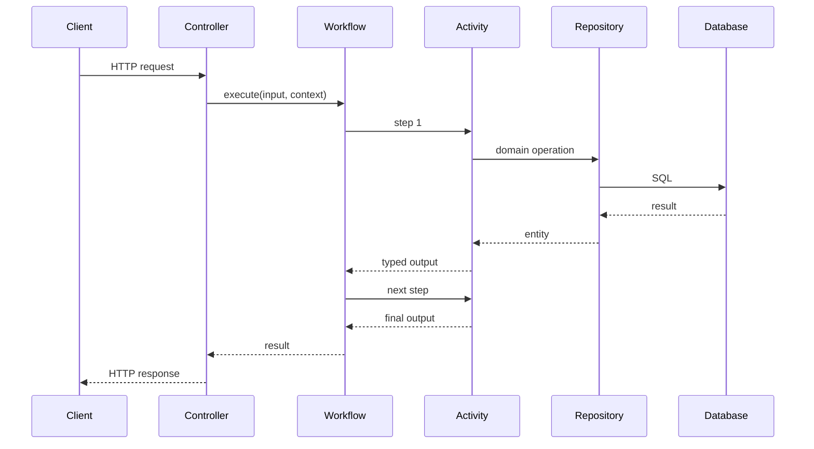
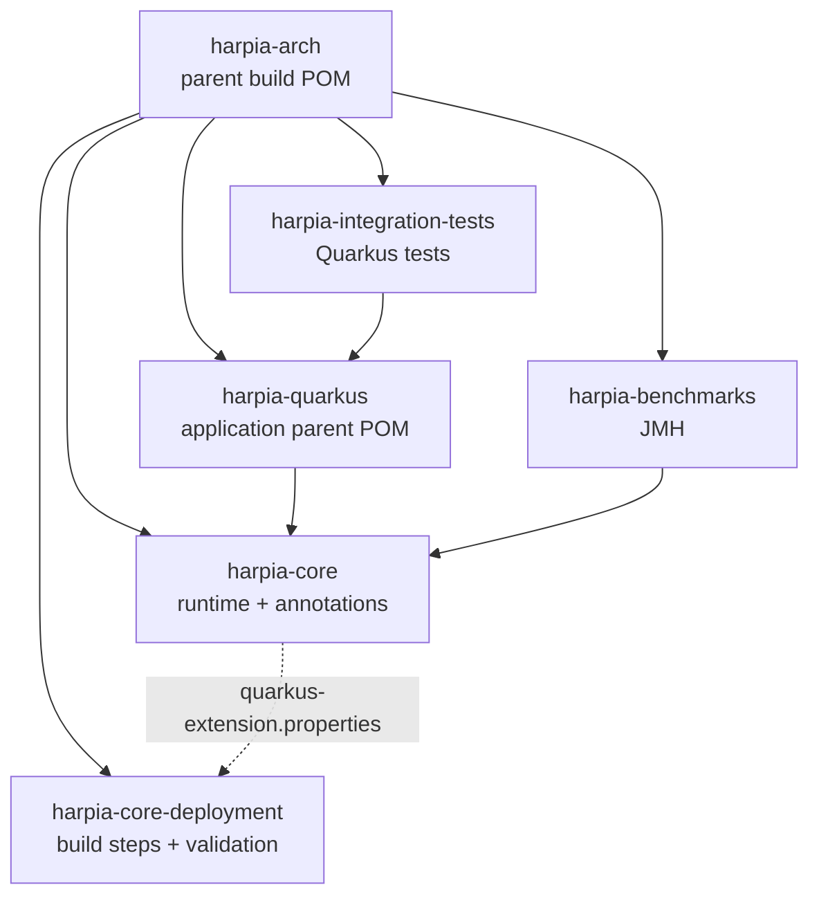
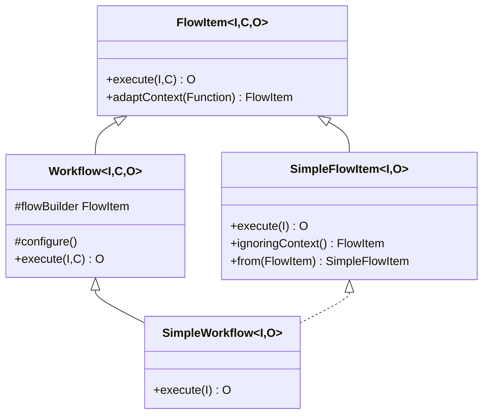

# Architecture overview

Harpia Arch organizes a Quarkus application around three ideas:

1. **explicit contract** — the input and output of each step are Java types;
2. **declarative composition** — the Workflow declares the order of the Activities;
3. **early validation** — architecture and composition errors appear before execution.

The result is a predictable flow: the Controller adapts HTTP, the Workflow coordinates the use case,
the Activities execute business rules and the Repository isolates persistence.

## Layers and responsibilities

| Layer | Annotation | Responsibility | Must not |
|---|---|---|---|
| HTTP entry | `@Controller` | Implement the interface generated by OpenAPI and translate HTTP into the Workflow | Declare `@Path`, verbs or implement `FlowItem` |
| Orchestration | `@WorkflowDefinition` | Declare the order of the steps and the input/output contract | Contain business rules or access the database directly |
| Step | `@Activity` | Execute a cohesive responsibility of the flow | Know the entire Workflow or expose HTTP |
| Business rule | `@Service` | Concentrate rules reusable by Activities and other services | Expose endpoints or depend on a Controller |
| Persistence | `@Repository` | Isolate `EntityManager`, queries and storage details | Depend on Controller, Service or Activity |
| Generic | `@Component` | Auxiliary role when no specific category applies | Replace a layer without justification |

The explicit layer rules — for example, `@Repository` must not depend on `@Controller` — are
verified at build time by `harpia-core-deployment`. The other separations in the table are
architectural guidelines. See [Build-time validation](../core/build-validation.md).

## Request flow

The Workflow does not know about HTTP. The Controller does not know the order of the Activities.
This separation makes it possible to test the use case without starting the web layer and to test
the HTTP adapter separately.

## Reactor structure

`harpia-core` is the runtime artifact. `harpia-core-deployment` is loaded by Quarkus during the
build and is not declared by the application. See [Modules](../modules.md) for the coordinates and
the role of each artifact.

## Runtime and build time

| Moment | What happens | Where |
|---|---|---|
| Source generation | The OpenAPI contract becomes JAX-RS interfaces and DTOs | `openapi-generator-maven-plugin` |
| Compilation | The compiler checks the input, output and context of every `.step()` | `javac` |
| Quarkus build | The annotations are registered and the architectural rules are validated with Jandex | `harpia-core-deployment` |
| CDI initialization | `@PostConstruct` calls `configure()` once | `Workflow` |
| Execution | The immutable composition is traversed through direct Java calls | `FlowItem`/`Stage` |

There is no dynamic discovery of Activities, no reading of annotations through reflection on the
critical path and no resolution of the context type at runtime. ArC may create CDI proxies for
`@ApplicationScoped` beans; that is the container's responsibility and does not change the typed
composition.

## Type model

The hierarchy allows four forms of executable unit:

- `FlowItem<I, C, O>` — Activity with context;
- `SimpleFlowItem<I, O>` — Activity without context;
- `Workflow<I, C, O>` — Workflow with context;
- `SimpleWorkflow<I, O>` — Workflow without context.

A `SimpleFlowItem` is a `FlowItem<I, Void, O>`, so it remains compatible with the full contract.
A `SimpleWorkflow` is also a `SimpleFlowItem`, which allows using it as a step of another flow.

## Lifecycle

1. The container creates the `@ApplicationScoped` bean.
2. `@PostConstruct` calls `initialize()`.
3. `configure()` builds the `flowBuilder` only once.
4. `execute()` reads the published composition and traverses it.
5. Subsequent executions reuse the same composition.

The `flowBuilder` field is `volatile`. The composition is immutable after construction; there is
no `ThreadLocal`, global state or request data in Workflow fields.

Details in [Workflow engine](../core/workflow-engine.md#lifecycle).

## Context

The context is optional. Two forms are supported:

- declare `Void` explicitly and stay on the three-parameter contract;
- omit the context with `SimpleFlowItem`/`SimpleWorkflow`.

The absence of a context does not create an empty object, does not use reflection and does not
perform dynamic resolution. See [Optional context](../core/context.md) for the full composition
matrix.

## Qualities and trade-offs

| Quality | How it is achieved | Trade-off |
|---|---|---|
| Type safety | Generics + a builder that changes the output type | Learning curve of the contracts |
| Fail fast | Compilation + Jandex validation | The build becomes stricter |
| Performance | Direct calls, composition built once | The flow is declarative, not dynamic |
| Concurrency | Immutable composition and per-execution context | The context must be thread-safe if it is mutable |
| Native Image | No reflective discovery in the engine | Dependencies still need Quarkus support |
| Testability | Workflow is a `FlowItem`; Activities are beans | Requires layer discipline |

## What is not part of the core

- Saga, compensation and automatic rollback;
- automatic retry;
- built-in observability, tracing and metrics;
- dynamic discovery of Activities;
- implicit conversion between contexts.

These behaviors can be implemented in the application or in future modules. See the
[Architectural decisions](decisions.md).
