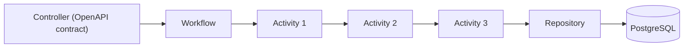

# Harpia Arch

A Java architecture for building processes with **Activities**, **Workflows** and hierarchical
composition, on top of Quarkus.

The goal is to abstract orchestration complexity without abstracting efficiency: strong typing,
build-time composition, native CDI, execution through direct Java calls and GraalVM Native Image
compatibility.

## Key features

- **Strongly typed**: the output of an Activity must be the input of the next one.
- **Hierarchical composition**: a Workflow is a step of another Workflow.
- **Optional context**: use explicit `Void` or `SimpleFlowItem`/`SimpleWorkflow` without a context.
- **Explicit context when needed**: typed adaptation, with no implicit conversion.
- **Single construction**: `configure()` runs in `@PostConstruct` and the flow is reused.
- **No reflection in the engine**: no dynamic discovery of Activities, no `Method.invoke` and no
  dynamic context resolution.
- **Build-time validation**: architectural rules fail the Quarkus build.
- **No `Object` in the chain**: composition through closures with concrete types.
- **Native Image**: tested with Hibernate ORM, H2 and REST.
- **PT/EN documentation**: versioned site in the same repository.

## Architecture



The Controller adapts HTTP; the Workflow declares the use case; the Activities execute rules; the
Repository isolates persistence. See [Architecture overview](architecture/overview.md) for details.

## Modules

| Module | Role |
|---|---|
| [`harpia-core`](modules.md) | Workflow engine, annotations and CDI stereotypes. |
| [`harpia-core-deployment`](modules.md) | Build-time architectural validation (automatic). |
| [`harpia-quarkus`](modules.md) | Recommended parent POM for Quarkus applications. |
| [`harpia-arch`](modules.md) | Build parent for the library. |

## Quick start

```xml
<parent>
    <groupId>io.github.krisner94</groupId>
    <artifactId>harpia-quarkus</artifactId>
    <version>1.0.0</version>
</parent>
```

```java
@Activity
public class ValidateCustomerActivity
        implements FlowItem<CustomerInput, CustomerContext, CustomerInput> {

    @Override
    public CustomerInput execute(CustomerInput input, CustomerContext context) {
        if (input.name() == null || input.name().isBlank()) {
            throw new IllegalArgumentException("name is required");
        }
        return input;
    }
}
```

```java
@WorkflowDefinition
public class CreateCustomerWorkflow
        extends Workflow<CustomerInput, CustomerContext, Customer> {

    private final ValidateCustomerActivity validate;
    private final CreateCustomerActivity create;

    public CreateCustomerWorkflow(ValidateCustomerActivity validate,
            CreateCustomerActivity create) {
        this.validate = validate;
        this.create = create;
    }

    @Override
    protected void configure() {
        flowBuilder = FlowBuilder.builder(CustomerInput.class, CustomerContext.class)
                .step(validate)
                .step(create)
                .build();
    }
}
```

Continue with [Getting started](getting-started.md).

## Documentation map

### Getting started

- [Getting started](getting-started.md)
- [Modules and coordinates](modules.md)
- [Configuration and build](guides/configuration.md)

### Core

- [Architecture overview](architecture/overview.md)
- [Workflow engine](core/workflow-engine.md)
- [Optional context](core/context.md)
- [Annotations](core/annotations.md)
- [Build validation](core/build-validation.md)
- [Errors and diagnostics](core/errors.md)

### Guides

- [Contract First](guides/contract-first.md)
- [Persistence](guides/persistence.md)
- [Security](guides/security.md)
- [Native Image](guides/native-image.md)
- [Testing](guides/testing.md)
- [Performance](guides/performance.md)
- [Benchmarks](guides/benchmarks.md)
- [Maven Central](guides/maven-central.md)

### Reference

- [Java API](reference/api.md)
- [Compatibility](reference/compatibility.md)
- [Glossary](reference/glossary.md)
- [Architectural decisions](architecture/decisions.md)
- [FAQ](faq.md)

### Project

- [Contributing](contributing.md)
- [Changelog](changelog.md)
