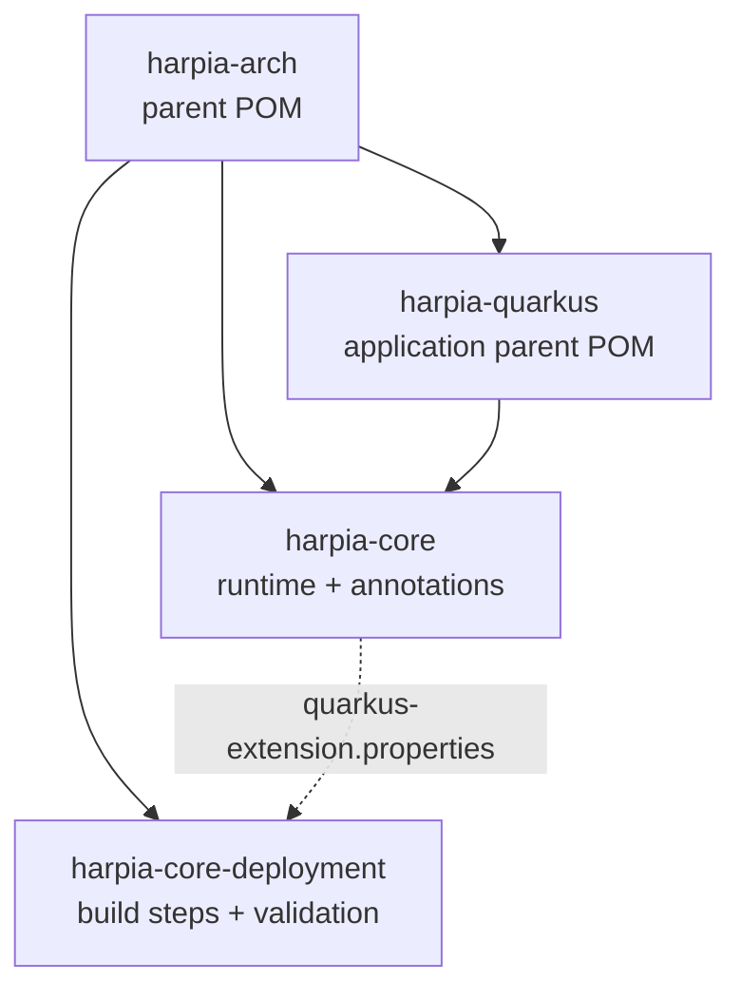

# Modules and coordinates

## Published artifacts

| Coordinate | Type | Consumption |
|---|---|---|
| `io.github.krisner94:harpia-arch:1.0.0` | POM | Build parent for the library |
| `io.github.krisner94:harpia-quarkus:1.0.0` | POM | **Recommended parent for applications** |
| `io.github.krisner94:harpia-core:1.0.0` | JAR | Engine, annotations and stereotypes |
| `io.github.krisner94:harpia-core-deployment:1.0.0` | JAR | Build-time validation (automatic) |

## Relationship between the modules



Quarkus reads the descriptor from `harpia-core`, resolves `harpia-core-deployment` and runs the build
steps during the build. The application never declares the deployment module.

## Reactor order

| Order | Module | Role |
|---|---|---|
| 1 | `harpia-arch` | Aggregates modules, imports the Quarkus BOM and defines versions |
| 2 | `harpia-core` | Engine runtime and annotations |
| 3 | `harpia-core-deployment` | Build steps and Jandex validation |
| 4 | `harpia-quarkus` | Parent for applications |
| 5 | `harpia-integration-tests` | Quarkus + Hibernate ORM + H2 tests |
| 6 | `harpia-benchmarks` | JMH |

## When to use each one

### `harpia-quarkus`

Use it as the application parent:

```xml
<parent>
    <groupId>io.github.krisner94</groupId>
    <artifactId>harpia-quarkus</artifactId>
    <version>1.0.0</version>
</parent>
```

It provides:

- the Quarkus BOM;
- `quarkus-arc`, `quarkus-rest` and `quarkus-rest-jackson`;
- `microprofile-openapi-api` and `jakarta.validation-api`;
- `harpia-core`;
- `quarkus-junit` and Rest Assured in test scope;
- `quarkus-maven-plugin` with `extensions=true`;
- compiler, Surefire and Failsafe;
- the `native` profile;
- the `harpia-openapi-codegen` profile.

### `harpia-core`

Use it as a dependency when the application already has another parent:

```xml
<dependency>
    <groupId>io.github.krisner94</groupId>
    <artifactId>harpia-core</artifactId>
    <version>1.0.0</version>
</dependency>
```

In this case, also declare the Quarkus extensions the application uses (`quarkus-rest`,
`quarkus-rest-jackson`, validation, persistence, etc.) and configure the OpenAPI codegen in your POM.

It contains:

- `FlowItem`, `SimpleFlowItem`, `Workflow`, `SimpleWorkflow`;
- `FlowBuilder`, `SimpleFlowBuilder`, `FlowConfigurationException`;
- `@HarpiaApplication`, `@Controller`, `@Service`, `@Repository`, `@Activity`,
  `@WorkflowDefinition`, `@Component`;
- `META-INF/quarkus-extension.yaml` and the extension descriptor.

### `harpia-core-deployment`

Do not declare it. Quarkus resolves the artifact from the `harpia-core` descriptor. It:

- registers the annotations as bean-defining;
- runs the architectural validation with Jandex;
- fails the build before the artifact is generated.

See [Build validation](core/build-validation.md).

### `harpia-arch`

Build parent for the library. It organizes the reactor, imports the Quarkus BOM and configures the
`harpia-openapi-codegen` profile.

It is not a runtime dependency and it is not the recommended parent for applications. For
applications, use `harpia-quarkus`.

## Internal modules

| Module | Role | Published |
|---|---|---|
| `harpia-integration-tests` | Quarkus tests with Hibernate ORM, H2, REST and Native Image | No |
| `harpia-benchmarks` | JMH benchmarks | No |
| `website` | Docusaurus PT/EN site | Not a Maven module |

## Runtime dependencies

| Module | Main dependencies |
|---|---|
| `harpia-core` | `quarkus-arc`; `jakarta.annotation-api` in `provided` |
| `harpia-core-deployment` | `harpia-core`; `quarkus-arc-deployment` |
| `harpia-integration-tests` | `harpia-quarkus`; `quarkus-hibernate-orm`; `quarkus-jdbc-h2` |

## Version and Java

- Current version: `1.0.0`.
- Java: 25.
- Quarkus: 3.40.1.1.
- GroupId: `io.github.krisner94`.
- Versioning and publishing: [Maven Central](guides/maven-central.md).
